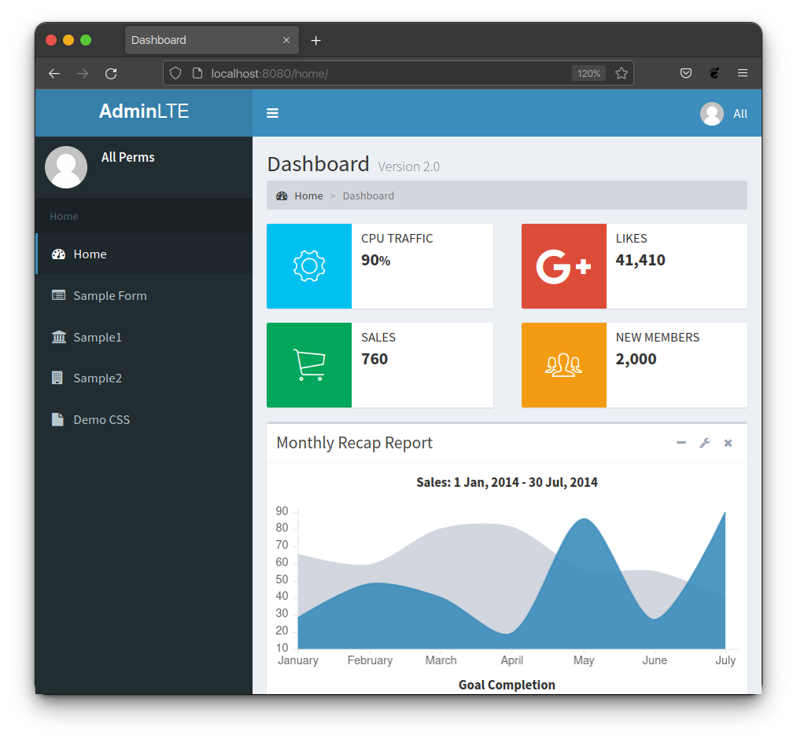
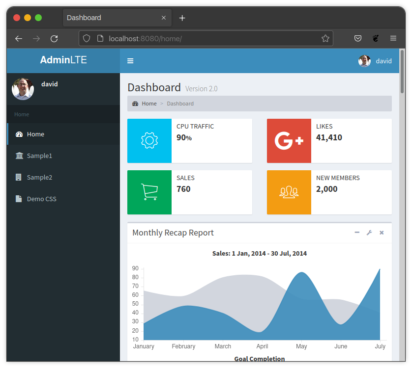
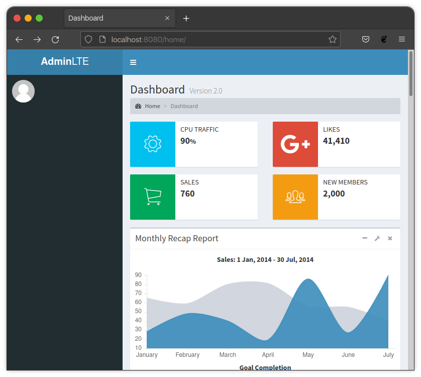
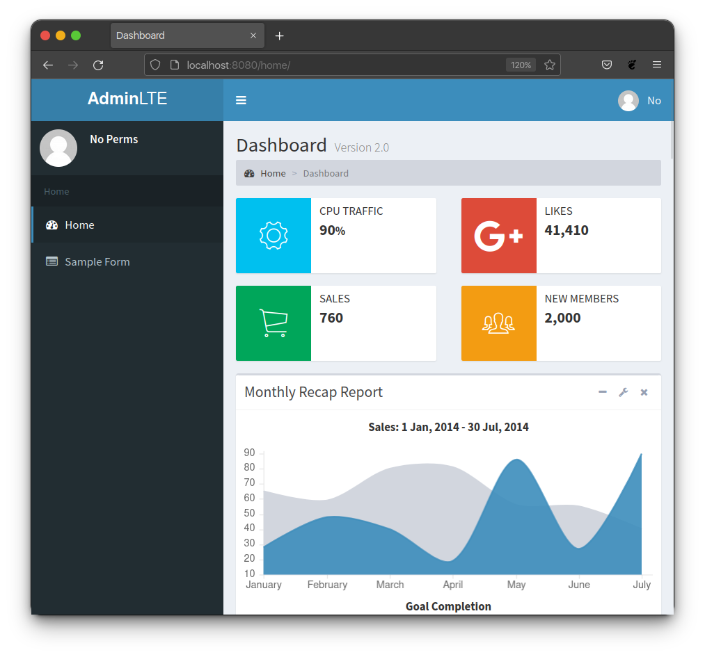
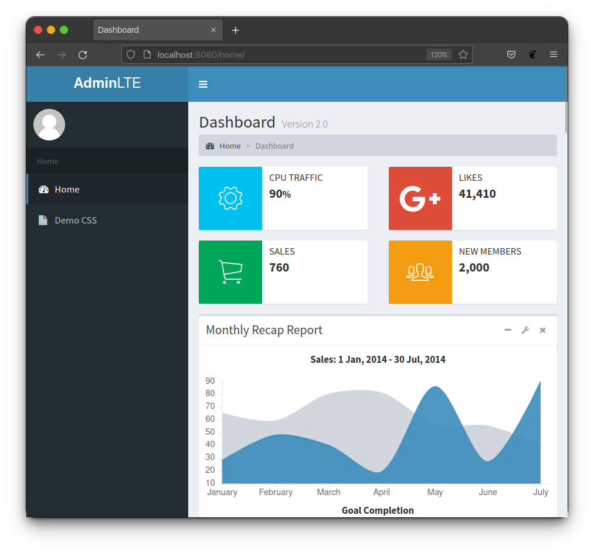
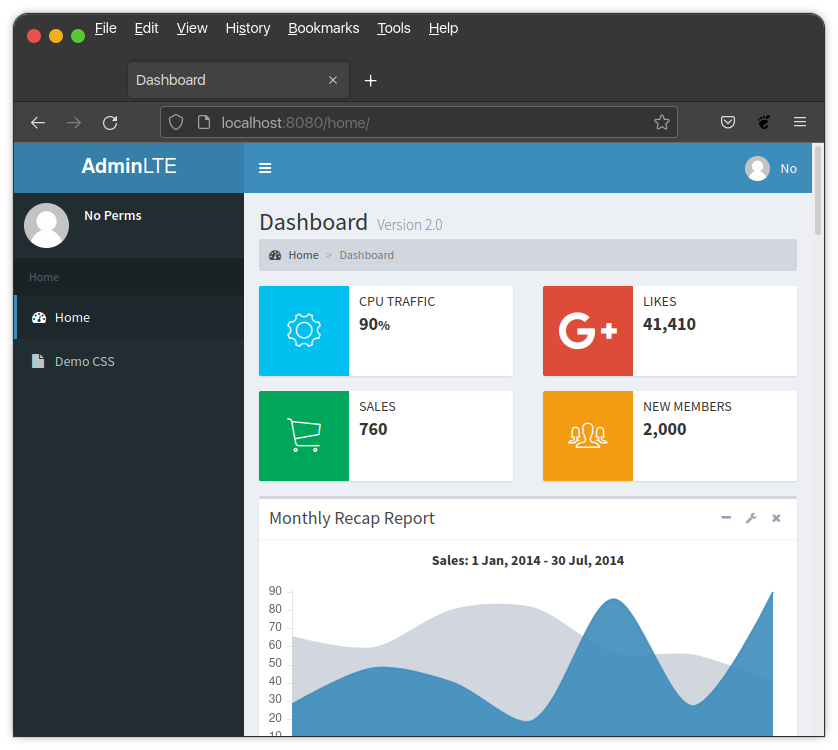

Authorizing Class Based Views
*****************************

Mixins
======

There are four mixins provided by Django-AdminLTE2-PDQ that can be used on a
class-based view to control whether a user:

* Has access to the protected view.
* Can see links in the sidebar, relating to the protected view.

Those mixins are:

* :ref:`authorization/class_views:login required mixin` imported with

  .. code:: python

      from adminlte2_pdq.mixins import LoginRequiredMixin

* :ref:`authorization/class_views:allow anonymous access mixin` imported with

  .. code:: python

      from adminlte2_pdq.mixins import AllowAnonymousAccessMixin

* :ref:`authorization/class_views:allow without permissions mixin` imported
  with

  .. code:: python

      from adminlte2_pdq.mixins import AllowWithoutPermissionsMixin

* :ref:`authorization/class_views:permission required mixin` imported with

  .. code:: python

      from adminlte2_pdq.mixins import PermissionRequiredMixin

Login Required Mixin
--------------------

``LoginRequiredMixin``

This mixin will enforce that a user is logged into the system before they
can access the view. Django's default
`LoginRequiredMixin <https://docs.djangoproject.com/en/dev/topics/auth/default/#the-loginrequired-mixin>`_
is used behind the scenes and is only recreated in this package to add
the magic of automatic sidebar link rendering and to follow
:ref:`configuration/authorization:ADMINLTE2_USE_LOGIN_NEXT`.

When using this mixin on a class based view, if the user is not logged in,
the user will not be able to access this view nor will they see a sidebar menu
entry that maps to this view. However, if the user is logged in,
they will see the sidebar link and have access.

.. code:: python

    from adminlte2_pdq.mixins import LoginRequiredMixin

    class DemoCss(LoginRequiredMixin, View):
        """Show the demo CSS home page."""
        def get(self, request):
            return render(request, 'adminlte2_demo_css/home.html')

.. note::

    This mixin is for the :ref:`authorization/policies:loose policy`. With
    :ref:`authorization/policies:login required` or the
    :ref:`authorization/policies:strict policy`, every view already requires
    login, and the middleware raises ``ImproperlyConfigured`` for a view with
    this mixin. Use no mixin (login required) or
    ``AllowWithoutPermissionsMixin`` (strict) instead.

Allow Anonymous Access Mixin
----------------------------

``AllowAnonymousAccessMixin``

This mixin lets anyone open the view, logged in or not, and shows its sidebar
link to everyone. With the strict policy, the view also doesn't need
permissions.

It is for the :ref:`authorization/policies:login required` and
:ref:`authorization/policies:strict policy` modes. In the loose policy every
view is already public, and the middleware raises ``ImproperlyConfigured`` for
a view with this mixin.

.. code:: python

    from adminlte2_pdq.mixins import AllowAnonymousAccessMixin

    class About(AllowAnonymousAccessMixin, View):
        """Show the public about page."""
        def get(self, request):
            return render(request, 'about.html')

.. note::

    A view with this mixin doesn't also need to be in
    ``ADMINLTE2_LOGIN_EXEMPT_WHITELIST``. When it is, the middleware warns,
    because the two do the same thing.

Allow Without Permissions Mixin
-------------------------------

``AllowWithoutPermissionsMixin``

This mixin lets every logged-in user open the view, without any permissions,
and shows its sidebar link to logged-in users. Anonymous users are redirected
to the login page. It is based on Django's ``LoginRequiredMixin``, so its
``login_url``, ``redirect_field_name``, and ``raise_exception`` attributes
work the same way. It follows
:ref:`configuration/authorization:ADMINLTE2_USE_LOGIN_NEXT`.

It is for the :ref:`authorization/policies:strict policy`, for pages every
logged-in user may see, such as a dashboard or a profile page. In the loose and
login required policies, views don't need permissions, and the middleware
raises ``ImproperlyConfigured`` for a view with this mixin.

.. code:: python

    from adminlte2_pdq.mixins import AllowWithoutPermissionsMixin

    class Profile(AllowWithoutPermissionsMixin, View):
        """Show the user's profile."""
        def get(self, request):
            return render(request, 'profile.html')

If the view's route is also in ``ADMINLTE2_LOGIN_EXEMPT_WHITELIST`` or
``ADMINLTE2_LOGIN_EXEMPT_FUZZY_WHITELIST``, it needs neither login nor
permissions, so anyone can open it, and the sidebar shows its link to anonymous
users too.

.. note::

    A view with this mixin doesn't also need to be in
    ``ADMINLTE2_STRICT_POLICY_WHITELIST``. When it is, the middleware warns,
    because the two do the same thing.

Permission Required Mixin
-------------------------

``PermissionRequiredMixin``

This mixin will enforce that a user has either all or one of a list of
permissions before they can access the view. Django's default
`PermissionRequired <https://docs.djangoproject.com/en/dev/topics/auth/default/#the-permissionrequiredmixin-mixin>`_
is used behind the scenes and is only recreated in this package to add
the magic of automatic sidebar link rendering and to follow
:ref:`configuration/authorization:ADMINLTE2_USE_LOGIN_NEXT`.

There are two class attributes used in conjunction with this mixin.
They are called ``permission_required`` and ``permission_required_one``.
Use ``permission_required`` when users need all of the listed permissions, and
``permission_required_one`` when they need at least one of them. When a view
sets both, users need all of the first and at least one of the second, and the
sidebar shows the link only to users who have both.

Each attribute takes a list (or tuple) of permissions, or a single permission
as a string:

.. code:: python

    permission_required = 'auth.view_permission'

Permission Required Attribute
^^^^^^^^^^^^^^^^^^^^^^^^^^^^^

.. code:: python

    from adminlte2_pdq.mixins import PermissionRequiredMixin

    class Sample1(PermissionRequiredMixin, View):
        """Show sample1 page"""

        # Require that the user has all three permissions to access.
        permission_required = [
            'auth.add_permission',
            'auth.change_permission',
            'auth.delete_permission'
        ]

        def get(self, request, *args, **kwargs):
            return render(request, 'adminlte2/sample1.html', {})

Permission Required One Attribute
^^^^^^^^^^^^^^^^^^^^^^^^^^^^^^^^^

.. note::

    Django does not provide a similar class level attribute by default.
    This attribute and its functionality are exclusive to this package.

.. tip::

    This class level attribute is good when you have a landing page for a
    section of your site and don't care whether the user can only read or has
    full edit permissions. Either one should allow the user to see the sidebar
    link and gain access to the landing page where further restrictions can be
    used as needed.

.. code:: python

    from adminlte2_pdq.mixins import PermissionRequiredMixin

    class Sample2(PermissionRequiredMixin, View):
        """Show sample2 page"""

        # Require that the user has at least one of the three permissions to access.
        permission_required_one = [
            'auth.add_permission',
            'auth.change_permission',
            'auth.delete_permission'
        ]

        def get(self, request, *args, **kwargs):
            return render(request, 'adminlte2/sample2.html', {})

Mixin Examples
==============

Loose Mixin Example
-------------------

In this example, there are five routes, views, and sidebar entries. To
demonstrate how our package works, we intentionally mess up the **Sample 2**
permissions at first, then show how to correct it. The views are as follows:

* **Home** - Should be visible to all users, regardless of being logged in or
  having permission.
* **Sample Form** - Requires simply being logged in to see and access.
* **Sample 1** - Requires two permissions (and thus being logged in) to see and
  access.
* **Sample 2** - Should require at least one of the listed permissions
  (and be logged in) to see and access. But we intentionally
  forgot to add that permission to demonstrate what will happen.
* **Demo CSS** - Should be visible to all users, regardless of being logged in
  or having permission.

.. note::

    In the below files, we have purposely made a mistake in regards to the
    **Sample2** view to not only demonstrate how the various files and
    contents work, but also to show what sort of side effects to expect when
    using the **Loose Policy**.

    Below this initial attempt, we correct our initial mistake and show the
    proper configuration, as well as what users will see.

.. important::

    For this example, we have turned off the global
    :ref:`authorization/policies:login required` setting and instead choose
    to define whether or not a view requires being logged in directly on
    the view rather than globally. This way we can demonstrate all three options
    available from the various mixins.

.. _loose_mixin_settings.py:

**settings.py**

.. code:: python

    # Sidebar menu definition.
    ADMINLTE2_MENU = [
        {
            'text': 'Home',
            'nodes': [
                {
                    'route': 'home',
                    'text': 'Home',
                    'icon': 'fa fa-dashboard',
                },
                {
                    'route': 'sample_form',
                    'text': 'Sample Form',
                    'icon': 'fa fa-list-alt'
                },
                {
                    'route': 'sample1',
                    'text': 'Sample1',
                    'icon': 'fa fa-bank'
                },
                {
                    'route': 'sample2',
                    'text': 'Sample2',
                    'icon': 'fa fa-building'
                },
                {
                    'route': 'demo-css',
                    'text': 'Demo CSS',
                    'icon': 'fa fa-file'
                },
            ]
        },
    ]
    # Ensures that we are using the Loose Policy.
    ADMINLTE2_USE_STRICT_POLICY = False

.. _loose_mixin_urls.py:

**urls.py**

.. code:: python

    urlpatterns = [
        path('home/', views.Home.as_view(), name="home"),
        path('sample_form/', views.SampleForm.as_view(), name="sample_form"),
        path('sample1/', views.Sample1.as_view(), name="sample1"),
        path('sample2/', views.Sample2.as_view(), name="sample2"),
        path('demo-css/', views.DemoCss.as_view(),name="demo-css"),
    ]

.. _loose_mixin_views.py:

**views.py**

.. code:: python

    from django.shortcuts import render
    from django.views import View
    from adminlte2_pdq.mixins import (
        LoginRequiredMixin,
        PermissionRequiredMixin,
    )

    class Home(View):
        """Show home page"""
        def get(self, request, *args, **kwargs):
            return render(request, 'adminlte2/home.html', {})

    class SampleForm(LoginRequiredMixin, View):
        """Show Sample Form Page"""

        def get(self, request):
            form = SampleForm()
            return render(request, 'adminlte2/sample_form.html', {'form':form})

    class Sample1(PermissionRequiredMixin, View):
        """Show sample1 page"""

        permission_required = ['auth.add_permission', 'auth.view_permission',]

        def get(self, request, *args, **kwargs):
            return render(request, 'adminlte2/sample1.html', {})

    class Sample2(View):
        """Show sample2 page"""

        def get(self, request, *args, **kwargs):
            return render(request, 'adminlte2/sample2.html', {})

    class DemoCss(View):
        """Show the demo CSS home page."""
        def get(self, request):
            return render(request, 'adminlte2_demo_css/home.html')

**What logged out anonymous users can see and access:**

**What logged in users without correct permissions can see and access:**

**What logged in users with correct perm can see and access:**

**What logged in superusers can see and access:**

.. warning::

    We wanted to prevent the **Sample2** view from being accessed by people that
    do not have at least one permission, but forgot to add that to our view.

    Because we are using a Loose policy, everyone can see and have access to this
    view. This is the **"Loose"** part of the loose policy as it defaults to
    everyone being able to see every view unless a permission is explicitly
    set on that view.

Let's fix our mistake so that **Sample2** is protected and see the difference.

.. _loose_mixin_fixed_views.py:

**views.py**

Add the missing ``PermissionRequiredMixin`` mixin and the
``permission_required_one`` attribute to the Sample2 view.

.. code:: python

    class Sample2(PermissionRequiredMixin, View):
        """Show sample2 page"""

        permission_required_one = [
            'auth.add_permission',
            'auth.view_permission',
        ]

        def get(self, request, *args, **kwargs):
            return render(request, 'adminlte2/sample2.html', {})

**What logged out users can see and access now:**

**What logged in users without correct permissions can see and access now:**

**What logged in user with correct perms can see and access now:**

**What logged in superusers can see and access now:**

The pages in our example are now displaying as they're supposed to be.

Strict Mixin Example
--------------------

In this example, there are five routes, views, and sidebar entries. To
demonstrate how our package works, we intentionally mess up the **Sample2** and
**Demo CSS** routes at first, then show how to correct them. The views are as
follows:

* **Home** - Should be shown to all logged-in users, regardless of
  permissions.
* **Sample Form** - Requires simply being logged in to see and access.
* **Sample 1** - Requires two permissions (and thus being logged in) to see and
  access.
* **Sample 2** - Should require at least one of the listed permissions
  (and be logged in) to see and access. But we intentionally
  forgot to add that permission to demonstrate what will happen.
* **Demo CSS** - Should be visible to all users, regardless of being logged in
  or having permission. But we intentionally forgot to add that view's route to
  the
  :ref:`configuration/authorization:ADMINLTE2_LOGIN_EXEMPT_WHITELIST` and the
  :ref:`configuration/authorization:ADMINLTE2_STRICT_POLICY_WHITELIST`
  to demonstrate what will happen.

.. note::

    In the below files, we have purposely made a mistake in regards to the
    **Sample2** and **Demo CSS** views to not only demonstrate how the
    various files and contents work, but also to show what sort of side effects
    to expect when using the **Strict Policy**.

    Below this initial attempt, we correct our mistake and show the proper
    configuration as well as what users will see.

.. important::

    The strict policy also turns on the global
    :ref:`authorization/policies:login required` setting, so every view
    requires login unless its route is in the login whitelist. Sample Form uses
    the ``AllowWithoutPermissionsMixin``, since the ``LoginRequiredMixin``
    isn't supported in strict mode.

.. _strict_mixin_settings.py:

**settings.py**

.. code:: python

    # Sidebar menu definition.
    ADMINLTE2_MENU = [
        {
            'text': 'Home',
            'nodes': [
                {
                    'route': 'home',
                    'text': 'Home',
                    'icon': 'fa fa-dashboard',
                },
                {
                    'route': 'sample_form',
                    'text': 'Sample Form',
                    'icon': 'fa fa-list-alt'
                },
                {
                    'route': 'sample1',
                    'text': 'Sample1',
                    'icon': 'fa fa-bank'
                },
                {
                    'route': 'sample2',
                    'text': 'Sample2',
                    'icon': 'fa fa-building'
                },
                {
                    'route': 'demo-css',
                    'text': 'Demo CSS',
                    'icon': 'fa fa-file'
                },
            ]
        },
    ]
    # Ensures that we are using the Strict Policy.
    ADMINLTE2_USE_STRICT_POLICY = True
    # The home route, which the permission whitelist includes by default.
    ADMINLTE2_HOME_ROUTE = 'home'

.. _strict_mixin_urls.py:

**urls.py**

.. code:: python

    urlpatterns = [
        path('home/', views.Home.as_view(), name="home"),
        path('sample_form/', views.SampleForm.as_view(), name="sample_form"),
        path('sample1/', views.Sample1.as_view(), name="sample1"),
        path('sample2/', views.Sample2.as_view(), name="sample2"),
        path('demo-css/', views.DemoCss.as_view(),name="demo-css"),
    ]

.. _strict_mixin_views.py:

**views.py**

.. code:: python

    from django.shortcuts import render
    from django.views import View
    from adminlte2_pdq.mixins import (
        AllowWithoutPermissionsMixin,
        PermissionRequiredMixin,
    )

    class Home(View):
        """Show home page"""
        def get(self, request, *args, **kwargs):
            return render(request, 'adminlte2/home.html', {})

    class SampleForm(AllowWithoutPermissionsMixin, View):
        """Show Sample Form Page"""

        def get(self, request):
            form = SampleForm()
            return render(request, 'adminlte2/sample_form.html', {'form':form})

    class Sample1(PermissionRequiredMixin, View):
        """Show sample1 page"""

        permission_required = ['auth.add_permission', 'auth.view_permission',]

        def get(self, request, *args, **kwargs):
            return render(request, 'adminlte2/sample1.html', {})

    class Sample2(View):
        """Show sample2 page"""

        def get(self, request, *args, **kwargs):
            return render(request, 'adminlte2/sample2.html', {})

    class DemoCss(View):
        """Show the demo CSS home page."""
        def get(self, request):
            return render(request, 'adminlte2_demo_css/home.html')

**What logged out users can see and access:**

    .. note::

        Logged out users are redirected to the login page for every route,
        including **Home**, since the strict policy requires login. **Home** is
        in the
        :ref:`configuration/authorization:adminlte2_strict_policy_whitelist`
        by default, so it doesn't need permissions, but it isn't in the login
        whitelist.
        For more information about the automatically included routes, check out
        the :ref:`authorization/policies:strict policy` section.

**What logged in users without correct permissions can see and access:**

**What logged in users with correct perm can see and access:**

**What logged in superusers can see and access:**

    .. note::
        Even though we forgot to add the **Demo CSS** route to the whitelists and
        add permissions to the **Sample2** view, the superuser still sees those
        sidebar entries, as superusers see every link. But opening them
        redirects to the home page: a view without permissions can't be opened
        by anyone in strict mode, superusers included.

.. warning::

    We wanted the **Demo CSS** view to be visible and accessible to all users.
    But as configured, only superusers see its link, and no one can open it.
    The same is true for the **Sample2** page.

    Because we are using the Strict Policy, all sidebar menu links are hidden
    by default. This is the **"Strict"** part of the Strict Policy as it
    defaults to everyone not being able to see every sidebar menu link unless a
    mixin is explicitly used on that view or the route for that view is
    added to the
    :ref:`configuration/authorization:ADMINLTE2_STRICT_POLICY_WHITELIST`.

    In the case of the **Demo CSS** view, we add the route to the
    ``ADMINLTE2_LOGIN_EXEMPT_WHITELIST`` and the
    ``ADMINLTE2_STRICT_POLICY_WHITELIST``, as we don't want to require
    any criteria to see it and instead want to ensure that everyone will be
    able to see the link and page regardless of their permissions or being
    logged in. Using the ``AllowAnonymousAccessMixin`` on the view instead
    would have the same effect.

    In the case of **Sample2**, we are going to add the missing permissions that
    we accidentally omitted earlier.

Let's fix our mistake so that **Demo CSS** and **Sample2** are visible to those
who they are supposed to be.

.. _strict_mixin_fixed_settings.py:

**settings.py**

Add the missing whitelists to the settings file and ensure they include the
demo-css route.

.. code:: python

    # Lists the routes that do not need login.
    ADMINLTE2_LOGIN_EXEMPT_WHITELIST = ['demo-css']
    # Lists the routes that do not need permissions.
    ADMINLTE2_STRICT_POLICY_WHITELIST = ['demo-css']

.. _strict_mixin_fixed_views.py:

**views.py**

Add the missing ``PermissionRequiredMixin`` mixin and
``permission_required_one`` attribute to the Sample2 view.

.. code:: python

    class Sample2(PermissionRequiredMixin, View):
        """Show sample2 page"""

        permission_required_one = [
            'auth.add_permission',
            'auth.view_permission',
        ]

        def get(self, request, *args, **kwargs):
            return render(request, 'adminlte2/sample2.html', {})

**What logged out users can see and access now:**

**What logged in users without correct permissions can see and access now:**

**What logged in user with correct perms can see and access now:**

**What logged in superusers can see and access now:**

.. image:: ../../img/authorization/strict_policy_superuser_correct.png
    :alt: Strict Policy with superuser and correct mixin/setting.

The pages in our example are now displaying as they're supposed to be.
