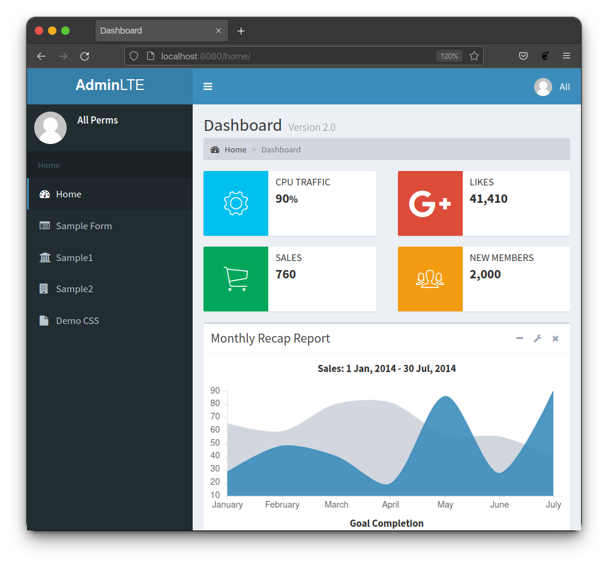
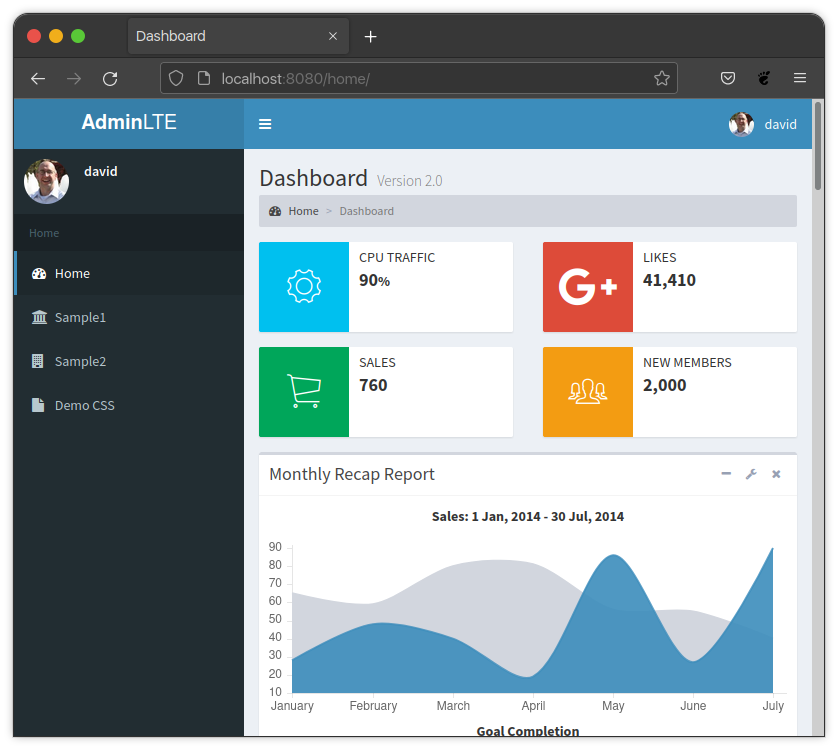
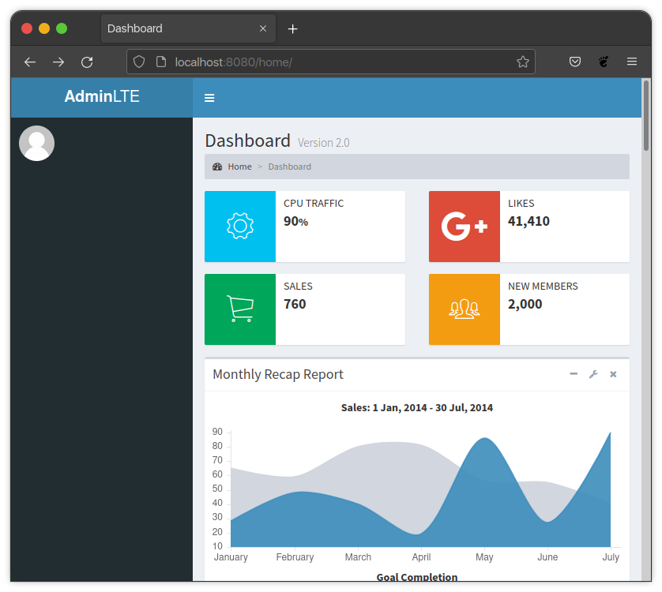
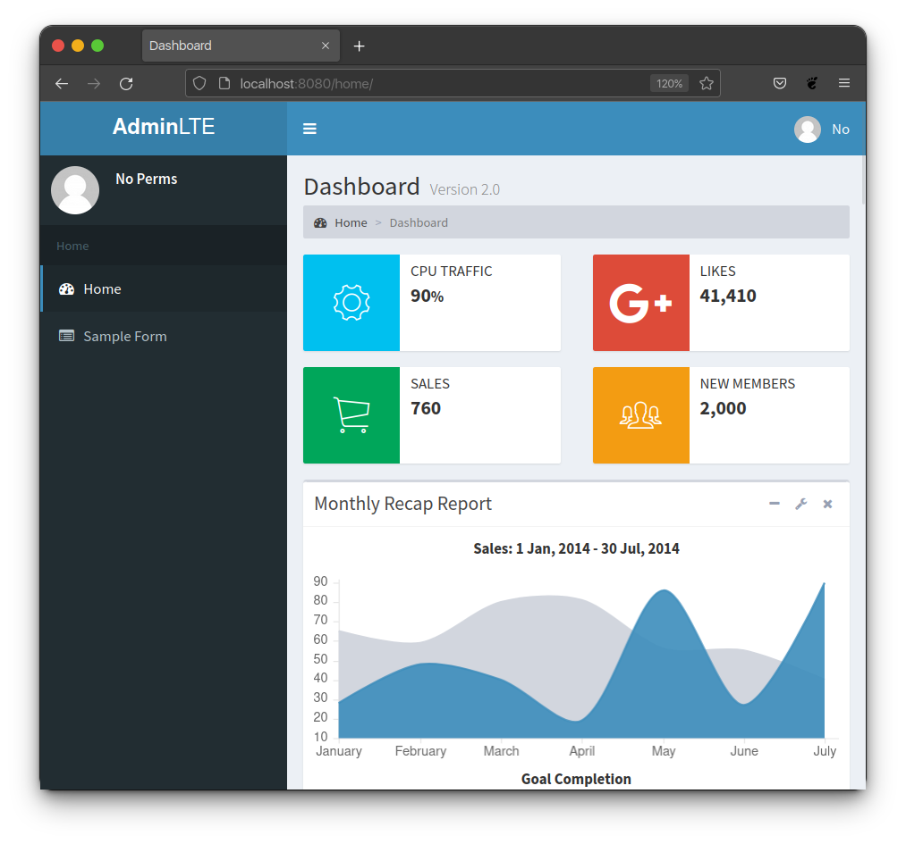
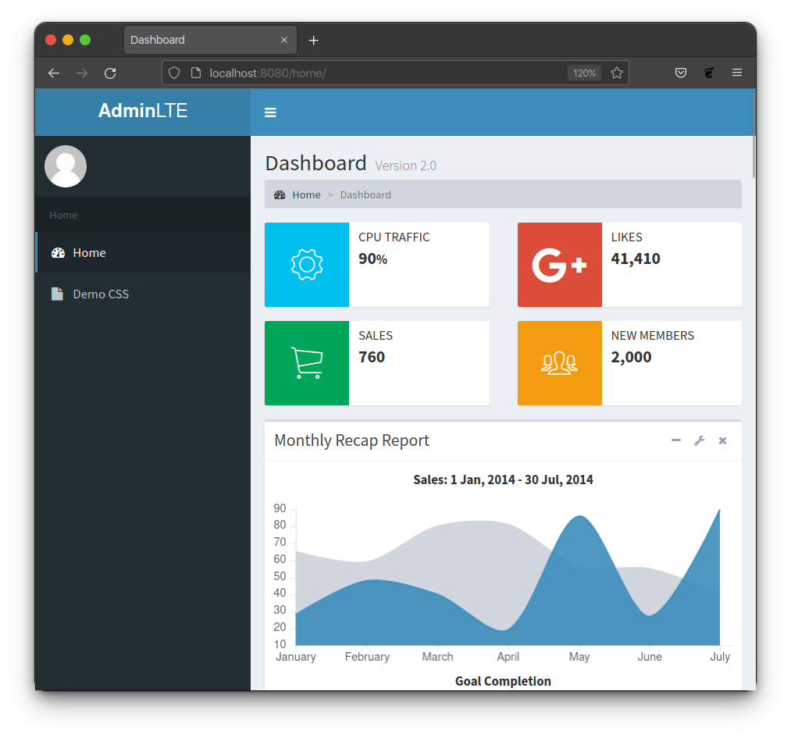
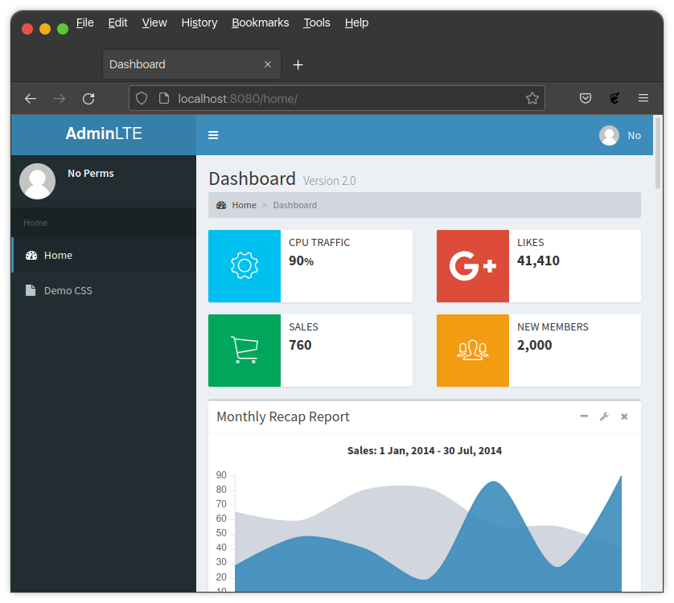

Authorizing Function Based Views
********************************

Decorators
==========

There are five decorators provided by Django-AdminLTE2-PDQ that can be used on a
function-based view to control whether a user:

* Has access to the decorated view.
* Can see links in the sidebar, relating to the decorated view.

Those decorators are:

* :ref:`authorization/function_views:login required decorator` imported with

  .. code:: python

      from adminlte2_pdq.decorators import login_required

* :ref:`authorization/function_views:allow anonymous access decorator`
  imported with

  .. code:: python

      from adminlte2_pdq.decorators import allow_anonymous_access

* :ref:`authorization/function_views:allow without permissions decorator`
  imported with

  .. code:: python

      from adminlte2_pdq.decorators import allow_without_permissions

* :ref:`authorization/function_views:permission required decorator` imported
  with

  .. code:: python

      from adminlte2_pdq.decorators import permission_required

* :ref:`authorization/function_views:permission required one decorator` imported
  with

  .. code:: python

      from adminlte2_pdq.decorators import permission_required_one

Login Required Decorator
------------------------

``@login_required``

This decorator will enforce that a user is logged into the system before they
can access the view. It works like Django's default
`login_required <https://docs.djangoproject.com/en/dev/topics/auth/default/#the-login-required-decorator>`_
decorator, and accepts the same ``redirect_field_name`` and ``login_url``
arguments. It is recreated in this package to add automatic sidebar link
rendering and to follow
:ref:`configuration/authorization:ADMINLTE2_USE_LOGIN_NEXT`.

When using this decorator on a function view, if the user is not logged in,
the user will not be able to access this view, nor will they see a sidebar menu
entry that maps to this view. However, if the user is logged in,
they will see the sidebar link and have access.

.. code:: python

    from adminlte2_pdq.decorators import login_required

    @login_required
    def demo_css(request):
        """Show the demo CSS home page."""
        return render(request, 'adminlte2_demo_css/home.html')

.. note::

    This decorator is for the
    :ref:`authorization/policies:loose policy`. With
    :ref:`authorization/policies:login required` or the
    :ref:`authorization/policies:strict policy`, every view already requires
    login, and the middleware raises ``ImproperlyConfigured`` for a view with
    this decorator. Use no decorator (login required) or
    ``allow_without_permissions`` (strict) instead.

Allow Anonymous Access Decorator
--------------------------------

``@allow_anonymous_access``

This decorator lets anyone open the view, logged in or not, and shows its
sidebar link to everyone. With the strict policy, the view also doesn't need
permissions.

It is for the :ref:`authorization/policies:login required` and
:ref:`authorization/policies:strict policy` modes. In the loose policy every
view is already public, and the middleware raises ``ImproperlyConfigured`` for
a view with this decorator.

.. code:: python

    from adminlte2_pdq.decorators import allow_anonymous_access

    @allow_anonymous_access
    def about(request):
        """Show the public about page."""
        return render(request, 'about.html')

.. note::

    A view with this decorator doesn't also need to be in
    ``ADMINLTE2_LOGIN_EXEMPT_WHITELIST``. When it is, the middleware warns,
    because the two do the same thing.

Allow Without Permissions Decorator
-----------------------------------

``@allow_without_permissions``

This decorator lets every logged-in user open the view, without any
permissions, and shows its sidebar link to logged-in users. Anonymous users are
redirected to the login page. It accepts the same ``redirect_field_name`` and
``login_url`` arguments as Django's ``login_required`` decorator, and follows
:ref:`configuration/authorization:ADMINLTE2_USE_LOGIN_NEXT`.

It is for the :ref:`authorization/policies:strict policy`, for pages every
logged-in user may see, such as a dashboard or a profile page. In the loose and
login required policies, views don't need permissions, and the middleware
raises ``ImproperlyConfigured`` for a view with this decorator.

.. code:: python

    from adminlte2_pdq.decorators import allow_without_permissions

    @allow_without_permissions
    def profile(request):
        """Show the user's profile."""
        return render(request, 'profile.html')

If the view's route is also in ``ADMINLTE2_LOGIN_EXEMPT_WHITELIST`` or
``ADMINLTE2_LOGIN_EXEMPT_FUZZY_WHITELIST``, it needs neither login nor
permissions, so anyone can open it, and the sidebar shows its link to anonymous
users too.

.. note::

    A view with this decorator doesn't also need to be in
    ``ADMINLTE2_STRICT_POLICY_WHITELIST``. When it is, the middleware warns,
    because the two do the same thing.

Permission Required Decorator
-----------------------------

``@permission_required``

This decorator will list all required permissions for the view. It works like
Django's
`permission_required <https://docs.djangoproject.com/en/dev/topics/auth/default/#the-permission-required-decorator>`_
decorator, and also shows or hides the view's sidebar links.

When using this decorator on a function view, if the user does not have all of
the permissions that we define in this decorator, the user will not be able to
access this view, nor will they see a sidebar menu entry that maps to this view.
However, if the user does have all of these permissions, they will see the
sidebar link and have access.

.. code:: python

    from adminlte2_pdq.decorators import permission_required

    @permission_required([
        'auth.add_group',
        'auth.change_group',
        'auth.delete_group'
    ])
    def sample1(request):
        """Show default sample1 page"""
        return render(request, 'adminlte2/sample1.html', {})

When the view needs only one permission, pass it as a string instead of a
list:

.. code:: python

    @permission_required('auth.view_group')
    def group_list(request):
        """Show the list of groups"""
        return render(request, 'groups/list.html', {})

Both permission decorators also take these arguments:

* ``login_url``: where a user without the permissions is redirected. It
  defaults to the :ref:`configuration/home:adminlte2_home_route`, where
  Django's decorator defaults to the login page.
* ``raise_exception``: when True, raise ``PermissionDenied`` (a 403 response)
  instead of redirecting.

With the middleware's built-in 403 handling on (the default), the middleware
redirects the user home before the view runs, so these arguments only apply
when that handling is off (see :ref:`authorization/policies:Handling 403s
Manually`).

Permission Required One Decorator
---------------------------------

``@permission_required_one``

This decorator will list the permissions that a user must have at least one
of to be able to access the view and see the associated sidebar link.

.. note::

    Django does not provide a similar decorator by default. This decorator is
    exclusive to this package.

When using this decorator on a function view, if the user does not have at
least one of the permissions that we define on this decorator, the user will
not be able to access this view, nor will they see a sidebar menu entry that
maps to this view. However, if the user has at least one of any of these
permissions, they will see the sidebar link and have access.

.. tip::

    This decorator is good when you have a landing page for a section of
    your site and don't care whether the user can only read or has full edit
    permissions. Either one should allow the user to see the sidebar link and
    gain access to the landing page where further restrictions can be used
    as needed.

.. code:: python

    from adminlte2_pdq.decorators import permission_required_one

    @permission_required_one([
        'auth.add_permission',
        'auth.change_permission',
        'auth.delete_permission'
    ])
    def sample2(request):
        """Show default sample2 page"""
        return render(request, 'adminlte2/sample2.html', {})

This decorator also accepts a single permission as a string.

Combining Permission Decorators
-------------------------------

``@permission_required_one`` and ``@permission_required`` can be used on the
same view. The user then needs at least one of the first list and all of the
second, and the sidebar shows the link only to users who have both.

.. code:: python

    from adminlte2_pdq.decorators import permission_required, permission_required_one

    @permission_required_one(['auth.view_group', 'auth.change_group'])
    @permission_required(['auth.view_user'])
    def group_members(request):
        """Show the members of each group"""
        return render(request, 'groups/members.html', {})

Several ``@permission_required`` decorators combine into one list of required
permissions. A view can only have one ``@permission_required_one`` decorator;
a second one raises ``ImproperlyConfigured``.

Decorator Examples
==================

Loose Decorator Example
-----------------------

In this example, there are five routes, views, and sidebar entries. To
demonstrate how our package works, we intentionally mess up the **Sample 2**
permissions at first, then show how to correct it. The views are as follows:

* **Home** - Should be visible to all users regardless of being logged in or
  having permission.
* **Sample Form** - Requires simply being logged in to see and access.
* **Sample 1** - Requires two permissions (and thus being logged in) to see and
  access.
* **Sample 2** - Should require at least one of the listed permissions
  (and be logged in) to see and access. But we intentionally
  forgot to add that permission to demonstrate what will happen.
* **Demo CSS** - Should be visible to all users regardless of being logged in
  or having permission.

Below is all the code required to generate these views.

.. note::

    In the below files, we have purposely made a mistake in regards to the
    **Sample2** view to not only demonstrate how the various files and
    contents work, but also to show what sort of side effects to expect when
    using the **Loose Policy**.

    Below this initial attempt, we correct our mistake and show the proper
    configuration, as well as what users will see.

.. important::

    For this example, we have turned off the global
    :ref:`authorization/policies:login required` setting and instead choose
    to define whether or not a view requires being logged in directly on
    the view rather than globally. This way we can demonstrate all three of
    the various decorators.

.. _loose_decorator_settings.py:

**settings.py**

.. code:: python

    # Sidebar menu definition.
    ADMINLTE2_MENU = [
        {
            'text': 'Home',
            'nodes': [
                {
                    'route': 'home',
                    'text': 'Home',
                    'icon': 'fa fa-dashboard',
                },
                {
                    'route': 'sample_form',
                    'text': 'Sample Form',
                    'icon': 'fa fa-list-alt'
                },
                {
                    'route': 'sample1',
                    'text': 'Sample1',
                    'icon': 'fa fa-bank'
                },
                {
                    'route': 'sample2',
                    'text': 'Sample2',
                    'icon': 'fa fa-building'
                },
                {
                    'route': 'demo-css',
                    'text': 'Demo CSS',
                    'icon': 'fa fa-file'
                },
            ]
        },
    ]
    # Ensures that we are using the Loose Policy.
    ADMINLTE2_USE_STRICT_POLICY = False

.. _loose_decorator_urls.py:

**urls.py**

.. code:: python

    urlpatterns = [
        path('home/', views.home, name="home"),
        path('sample_form/', views.sample_form, name="sample_form"),
        path('sample1/', views.sample1, name="sample1"),
        path('sample2/', views.sample2, name="sample2"),
        path('demo-css/', views.demo_css, name="demo-css"),
    ]

.. _loose_decorator_views.py:

**views.py**

.. code:: python

    from django.shortcuts import render
    from adminlte2_pdq.decorators import (
        login_required,
        permission_required,
        permission_required_one,
    )

    def home(request):
        """Show home page"""
        return render(request, 'adminlte2/home.html', {})

    @login_required()
    def sample_form(request):
        """Show sample form"""
        form = SampleForm()
        return render(request, 'adminlte2/sample_form.html', {'form':form})

    @permission_required(['auth.add_permission', 'auth.view_permission',])
    def sample1(request):
        """Show sample1 page"""
        return render(request, 'adminlte2/sample1.html', {})

    def sample2(request):
        """Show sample2 page"""
        return render(request, 'adminlte2/sample2.html', {})

    def demo_css(request):
        """Show the demo CSS home page."""
        return render(request, 'adminlte2_demo_css/home.html')

**What logged out anonymous users can see and access:**

**What logged in users without correct permissions can see and access:**

**What logged in users with correct permissions can see and access:**

**What logged in superusers can see and access:**

.. warning::

    We wanted to prevent the **Sample2** view from being accessed by people that
    do not have at least one permission, but forgot to add that to our view.

    Because we are using a Loose policy, everyone can see and have access to
    this view. This is the **"Loose"** part of the loose policy, as it defaults
    to everyone being able to see every view unless a decorator is explicitly
    used on that view.

Let's fix our mistake so that **Sample2** is protected and see the difference.

.. _loose_decorator_fixed_views.py:

**views.py**

Add the missing ``permission_required_one`` decorator to the Sample2 view.

.. code:: python

    @permission_required_one(['auth.add_permission', 'auth.view_permission',])
    def sample2(request):
        """Show sample2 page"""
        return render(request, 'adminlte2/sample2.html', {})

**What logged out users can see and access now:**

**What logged in users without correct permissions can see and access now:**

**What logged in users with correct permissions can see and access now:**

**What logged in superusers can see and access now:**

.. image:: ../../img/authorization/loose_policy_superuser_correct.png
    :alt: Loose Policy with superuser and correct decorator.

The pages in our example are now displaying as they're supposed to be.

Strict Decorator Example
------------------------

In this example, there are five routes, views, and sidebar entries. To
demonstrate how our package works, we intentionally mess up the **Sample2** and
**Demo CSS** routes at first, then show how to correct them. The views are as
follows:

* **Home** - Should be visible to all logged-in users, regardless of
  permissions.
* **Sample Form** - Requires simply being logged in to see and access.
* **Sample 1** - Requires two permissions (and thus being logged in) to see and
  access.
* **Sample 2** - Should require at least one of the listed permissions
  (and be logged in) to see and access. But we intentionally
  forgot to add that permission to demonstrate what will happen.
* **Demo CSS** - Should be visible to all users, regardless of being logged in
  or having permission. But we intentionally forgot to add that view's route to
  the
  :ref:`configuration/authorization:ADMINLTE2_LOGIN_EXEMPT_WHITELIST` and the
  :ref:`configuration/authorization:ADMINLTE2_STRICT_POLICY_WHITELIST`
  to demonstrate what will happen.

Below is all the code required to generate these views.

.. note::

    In the below files, we have purposely made a mistake in regards to the
    **Sample2** and **Demo CSS** views to not only demonstrate how the
    various files and contents work, but also to show what sort of side effects
    to expect when using the **Strict Policy**.

    Below this initial attempt, we correct our mistake and show the proper
    configuration as well as what users will see.

.. important::

    The strict policy also turns on the global
    :ref:`authorization/policies:login required` setting, so every view
    requires login unless its route is in the login whitelist. Sample Form uses
    the ``allow_without_permissions`` decorator, since the ``login_required``
    decorator isn't supported in strict mode.

.. _strict_decorator_settings.py:

**settings.py**

.. code:: python

    # Sidebar menu definition.
    ADMINLTE2_MENU = [
        {
            'text': 'Home',
            'nodes': [
                {
                    'route': 'home',
                    'text': 'Home',
                    'icon': 'fa fa-dashboard',
                },
                {
                    'route': 'sample_form',
                    'text': 'Sample Form',
                    'icon': 'fa fa-list-alt'
                },
                {
                    'route': 'sample1',
                    'text': 'Sample1',
                    'icon': 'fa fa-bank'
                },
                {
                    'route': 'sample2',
                    'text': 'Sample2',
                    'icon': 'fa fa-building'
                },
                {
                    'route': 'demo-css',
                    'text': 'Demo CSS',
                    'icon': 'fa fa-file'
                },
            ]
        },
    ]
    # Ensures that we are using the Strict Policy.
    ADMINLTE2_USE_STRICT_POLICY = True
    # The home route, which the permission whitelist includes by default.
    ADMINLTE2_HOME_ROUTE = 'home'

.. _strict_decorator_urls.py:

**urls.py**

.. code:: python

    urlpatterns = [
        path('home/', views.home, name="home"),
        path('sample_form/', views.sample_form, name="sample_form"),
        path('sample1/', views.sample1, name="sample1"),
        path('sample2/', views.sample2, name="sample2"),
        path('demo-css/', views.demo_css, name="demo-css"),
    ]

.. _strict_decorator_views.py:

**views.py**

.. code:: python

    from django.shortcuts import render
    from adminlte2_pdq.decorators import (
        allow_without_permissions,
        permission_required,
        permission_required_one,
    )

    def home(request):
        """Show home page"""
        return render(request, 'adminlte2/home.html', {})

    @allow_without_permissions
    def sample_form(request):
        """Show sample form"""
        form = SampleForm()
        return render(request, 'adminlte2/sample_form.html', {'form':form})

    @permission_required(['auth.add_permission', 'auth.view_permission',])
    def sample1(request):
        """Show sample1 page"""
        return render(request, 'adminlte2/sample1.html', {})

    def sample2(request):
        """Show sample2 page"""
        return render(request, 'adminlte2/sample2.html', {})

    def demo_css(request):
        """Show the demo CSS home page."""
        return render(request, 'adminlte2_demo_css/home.html')

**What logged out users can see and access:**

    .. note::

        Logged out users are redirected to the login page for every route,
        including **Home**, since the strict policy requires login. **Home** is
        in the
        :ref:`configuration/authorization:adminlte2_strict_policy_whitelist`
        by default, so it doesn't need permissions, but it isn't in the login
        whitelist.

**What logged in users without correct permissions can see and access:**

**What logged in users with correct perm can see and access:**

**What logged in superusers can see and access:**

    .. note::
        Even though we forgot to add the **Demo CSS** route to the whitelists and
        add permissions to the **Sample2** view, the superuser still sees those
        sidebar entries, as superusers see every link. But opening them
        redirects to the home page: a view without permissions can't be opened
        by anyone in strict mode, superusers included.

.. warning::

    We wanted the **Demo CSS** view to be visible and accessible to all users.
    But as configured, only superusers see its link, and no one can open it.
    The same is true for the **Sample2** page.

    Because we are using the Strict Policy, all sidebar menu links are hidden
    by default. This is the **"Strict"** part of the Strict Policy as it
    defaults to everyone not being able to see every sidebar menu link unless a
    decorator is explicitly used on that view or the route for that view is
    added to the
    :ref:`configuration/authorization:ADMINLTE2_STRICT_POLICY_WHITELIST`.

    In the case of the **Demo CSS** view, we add the route to the
    ``ADMINLTE2_LOGIN_EXEMPT_WHITELIST`` and the
    ``ADMINLTE2_STRICT_POLICY_WHITELIST``, as we don't want to require
    any criteria to see it and instead want to ensure that everyone will be
    able to see the link and page regardless of their permissions or being
    logged in. Using the ``allow_anonymous_access`` decorator on the view
    instead would have the same effect.

    In the case of **Sample2**, we are going to add the missing permissions that
    we accidentally omitted earlier.

Let's fix our mistake so that **Demo CSS** and **Sample2** are visible to those
who they are supposed to be.

.. _strict_decorator_fixed_settings.py:

**settings.py**

Add the missing whitelists to the settings file and ensure they include the
demo-css route.

.. code:: python

    # Lists the routes that do not need login.
    ADMINLTE2_LOGIN_EXEMPT_WHITELIST = ['demo-css']
    # Lists the routes that do not need permissions.
    ADMINLTE2_STRICT_POLICY_WHITELIST = ['demo-css']

.. _strict_decorator_fixed_views.py:

**views.py**

Add the missing ``permission_required_one`` decorator to the Sample2 view.

.. code:: python

    @permission_required_one(['auth.add_permission', 'auth.view_permission',])
    def sample2(request):
        """Show sample2 page"""
        return render(request, 'adminlte2/sample2.html', {})

**What logged out users can see and access now:**

**What logged in users without correct permissions can see and access now:**

**What logged in users with correct permissions can see and access now:**

**What logged in superusers can see and access now:**

The pages in our example are now displaying as they're supposed to be.
