Templates
*********

General
=======

The main purpose of the **Django-AdminLTE2-PDQ** package is to streamline the
creation of `Django <https://www.djangoproject.com/>`_ sites, using the
`AdminLTE2 <https://adminlte.io/themes/AdminLTE/index2.html>`_ theme.

As such, this package comes with many templates that are used right out of the
box and an automagically-customized site look and feel, just by following the
minimal steps as described in :doc:`../quickstart`.

All of these templates can be overridden to further customize the look
and feel of the site, depending on project needs. Rather than listing out every
single file and every single block within those files that can be overridden,
it is preferable that you just reference the files yourself. The files can be
found on
`GitHub <https://github.com/DJBarnes/django-adminlte2-pdq/tree/main/adminlte2_pdq/templates>`_.

.. important::

    In ``settings.py``, if you are using
    `APP_DIRS <https://docs.djangoproject.com/en/dev/howto/overriding-templates/#overriding-from-an-app-s-template-directory>`_
    to override templates, you must ensure that the app you are using to house
    those templates is listed in the
    `INSTALLED_APPS <https://docs.djangoproject.com/en/dev/ref/settings/#std-setting-INSTALLED_APPS>`_
    setting before the **django-adminlte2-pdq** app. Additionally, the
    **django-adminlte2-pdq** app should be listed before any Django apps.

Overriding Blocks
=================

To change part of a package template, create a template with the same path in
one of your project's template folders, extend the package's template, and
override only the blocks you want to change. Django finds your template first,
and ```` with the same path then loads the package's template
underneath it. A block left empty removes its content, a block with content
replaces it, and ``{{ block.super }}`` keeps the original content in place.

The package's templates have two kinds of blocks:

* `Page Blocks`_ are in the template that a page extends. A page overrides
  them in its own template.
* `Partial Blocks`_ are in the header, sidebar, and footer templates. A
  project overrides them once, for every page.

Each example below shows the page before and after the change.

Page Blocks
===========

Page blocks are for the parts of a page that change from page to page: the
title, the page header, the breadcrumbs, the content, and the page's own
stylesheets and scripts. Pages extend ``adminlte2/base.html``, and the pages
for users who aren't logged in, such as the login page, extend
``adminlte2/base_anonymous.html``.

The Login Page
--------------

The login page is ``registration/login.html``. By default, it looks like this:

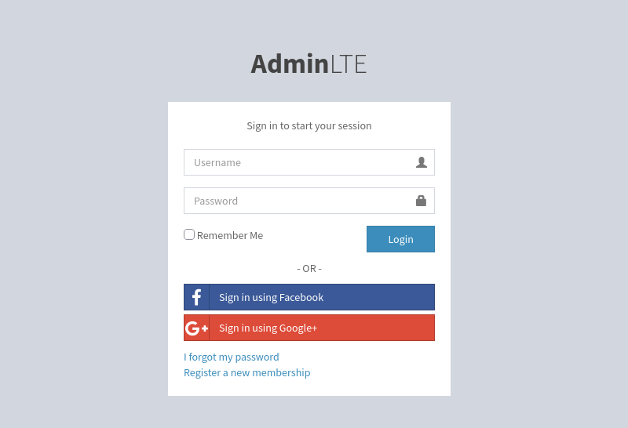

To change it:

1.  Create ``registration/login.html`` in one of your Django project's
    `template <https://docs.djangoproject.com/en/dev/ref/settings/#templates>`_
    folders.
2.  Extend the package's ``registration/login.html``:

    .. code:: html+django

        

3.  Override the blocks to change.

**Removing the social links**

An empty ``social_auth_links`` block removes the social login buttons:

.. code:: html+django

    

    

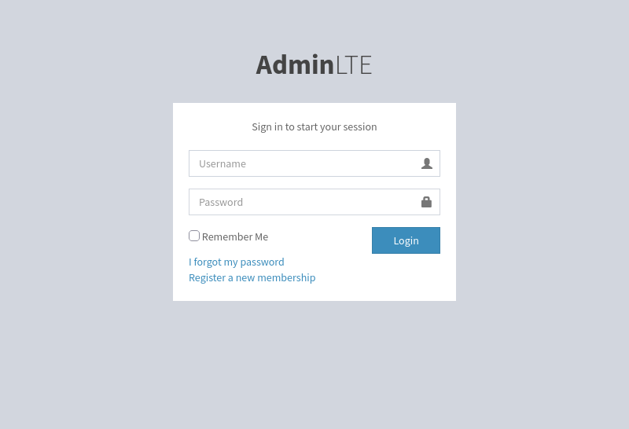

**Replacing the social links**

A ``social_auth_links`` block with content replaces the buttons:

.. code:: html+django

    

    
      

        
- OR -

        <a href="#" class="btn btn-block btn-social btn-github btn-flat">
          <i class="fa fa-github"></i>
          Sign in using GitHub
        </a>
      

    

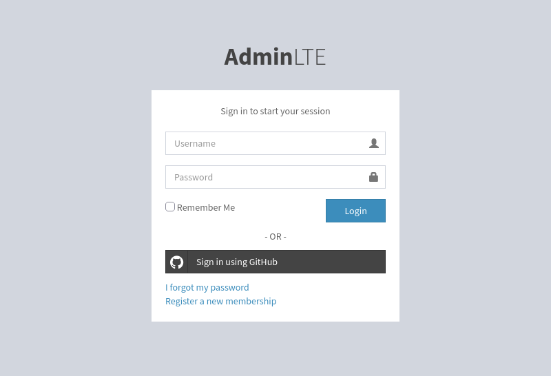

**Changing several parts**

One template can override as many blocks as needed. This one changes the page
title shown in the browser tab, changes the instructions, removes the social
links, and removes the "Register a new membership" link, for a site that
doesn't let users register themselves:

.. code:: html+django

    

    Sign In | Example Company

    
      
Sign in with your Example Company account

    

    

    
      <a href="">I forgot my password</a>
    

The other pages for users who aren't logged in, such as the password reset
pages, extend ``adminlte2/base_anonymous.html`` and have the same blocks.

A Page
------

A page template extends ``adminlte2/base.html`` and overrides its page
blocks. With no blocks overridden, a page has the header, sidebar, and footer,
and nothing else:

.. code:: html+django

    

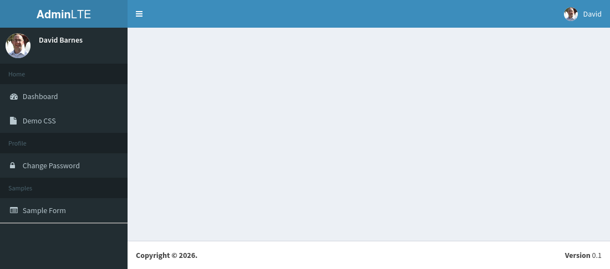

This page sets the title shown in the browser tab, the page name and
description, the breadcrumbs, and the content:

**reports/monthly_report.html**

.. code:: html+django

    

    Monthly Report | Example Company

    Monthly Report

    November 2026

    
      <ol class="breadcrumb">
        <li><a href=""><i class="fa fa-dashboard"></i> Home</a></li>
        <li class="active">Monthly Report</li>
      </ol>
    

    
      

        

          <h3 class="box-title">Orders</h3>
        

        

          
1,204

          

        

      

    

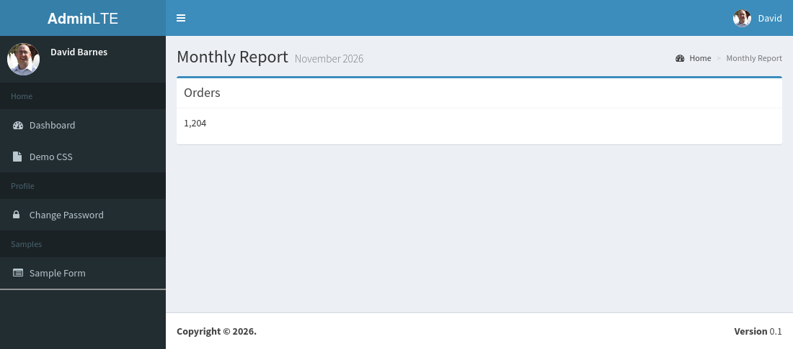

To show a page in the sidebar, add it to the menu (see :doc:`../menu/general_information`).

A Page's Stylesheets and Scripts
--------------------------------

The ``page_stylesheets`` block is in the page's ``<head>``, after the
package's stylesheets, so its styles win. The ``page_javascript_body`` block
is at the end of the ``<body>``, after the page's content. Both are empty in
``adminlte2/base.html``. ``{{ block.super }}`` keeps whatever a parent
template puts in them, so the page still works if it later extends a project
template that adds its own.

These blocks, added to the monthly report page above, make the total larger
and show when the page was loaded:

**reports/monthly_report.html**

.. code:: html+django

    
    

    {# The blocks from the previous example. #}

    
      {{ block.super }}
      <link rel="stylesheet" href="">
    

    
      {{ block.super }}
      
    

**reports/css/report.css**

.. code:: css

    .report-total {
      font-size: 3em;
      font-weight: bold;
      color: #00a65a;
    }

**reports/js/report.js**

.. code:: javascript

    document.getElementById("report-updated").textContent = "Updated " + new Date().toLocaleDateString();

Before, as in the previous example:

After:

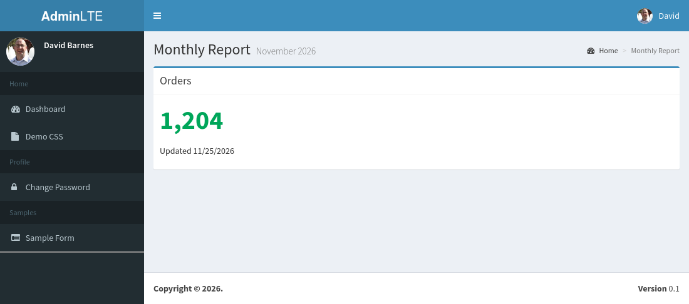

For styles and scripts on every page, override
``adminlte2/partials/_styles.html`` or ``adminlte2/partials/_scripts.html``
(see :ref:`configuration/front_end_styling:Template Blocks`).

Partial Blocks
==============

The header, sidebar, and footer are in partial templates, which
``adminlte2/base.html`` includes:

* ``adminlte2/partials/_main_header.html``
* ``adminlte2/partials/_main_sidebar.html``
* ``adminlte2/partials/_main_footer.html``

Django renders an included template on its own, with no access to the blocks
of the template that includes it. So a page template that overrides a block
from a partial, such as ``version_number``, has no effect. To change one of
these blocks, override the partial template itself. The change applies to
every page.

A page can still replace a whole partial: ``adminlte2/base.html`` includes
each one inside a block (``nav_header``, ``nav_sidebar``, and ``nav_footer``),
so a page can override that block to include a different template, or leave
it empty to remove the header, sidebar, or footer from that page.

The Footer
----------

The footer shows a copyright with the current year, and a version number that
defaults to 0.1:

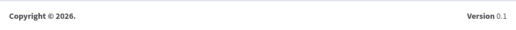

Its blocks are in ``adminlte2/partials/_main_footer.html``, so override that
template. This one sets the copyright text and the version number on every
page:

**adminlte2/partials/_main_footer.html**

.. code:: html+django

    

    
      <strong>Copyright &copy;  Example Company.</strong> All rights reserved.
    

    2.4.1

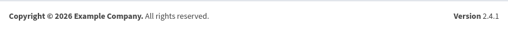

The User Dropdown
-----------------

Clicking the user's name in the top right opens a dropdown with "Change
password" and "Sign out" buttons:

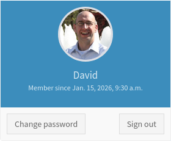

Its blocks are in ``adminlte2/partials/_main_header.html``. This one replaces
the "Change password" button with a "Profile" button, for a site whose profile
page links to the password change page. Here, ``profile`` is the URL name of
your project's profile view:

**adminlte2/partials/_main_header.html**

.. code:: html+django

    

    
      

        <a href="" class="btn btn-default btn-flat">Profile</a>
      

    

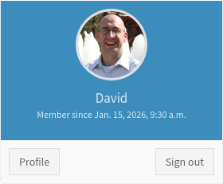

The dropdown only has room for two buttons side by side. A third one wraps
onto a new line.

The Sidebar User Panel
----------------------

The top of the sidebar shows the user's picture and name:

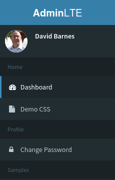

Its blocks are in ``adminlte2/partials/_main_sidebar.html``. An empty
``sb_user_panel`` block removes the panel, and the menu moves up:

**adminlte2/partials/_main_sidebar.html**

.. code:: html+django

    

    

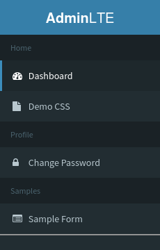

All Templates and Blocks
========================

See the
`package's templates on GitHub <https://github.com/DJBarnes/django-adminlte2-pdq/tree/main/adminlte2_pdq/templates>`_
for every template and block that can be overridden.
